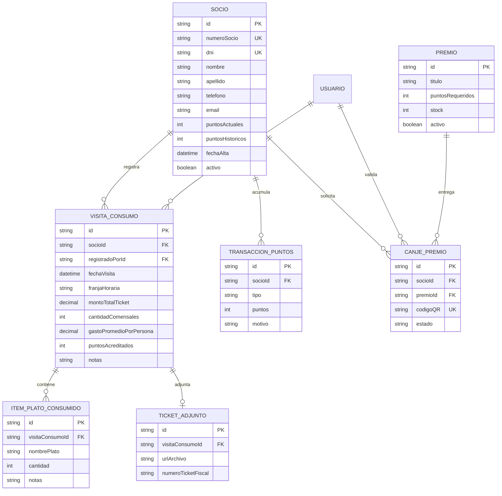

# 02 - Modelo de Datos y Esquema Prisma

## 1. Diagrama Entidad-Relación (Conceptual)

---

## 2. Definición de Tablas y Atributos

### 2.1. `Socio`
Representa al cliente miembro del programa de fidelización.
- `id` (UUID, PK): Identificador único interno.
- `numeroSocio` (String, Unique): Número de socio visible en su credencial.
- `dni` (String, Unique, Index): Documento de identidad utilizado para login rápido.
- `nombre` (String) y `apellido` (String): Datos personales.
- `telefono` (String, Nullable): Para contacto y futuras notificaciones.
- `email` (String, Nullable): Correo electrónico del cliente.
- `puntosActuales` (Int, Default: 0): Saldo disponible para canjear en cualquier momento.
- `puntosHistoricos` (Int, Default: 0): Puntos totales acumulados en su historia (determina ranking / nivel sin descontar canjes).
- `activo` (Boolean, Default: true): Para suspender cuentas si fuese necesario.

### 2.2. `Usuario` (Personal del Restaurante)
- `id` (UUID, PK): Identificador del usuario.
- `username` (String, Unique): Nombre de usuario para login interno.
- `nombre` (String): Nombre del empleado (mozo, cajero o gerente).
- `role` (Enum): `ADMIN`, `MOZO`, `CAJERO`.
- `passwordHash` (String): Contraseña encriptada con bcrypt.
- `activo` (Boolean, Default: true).

### 2.3. `VisitaConsumo` (Registro de la Mesa y Asistencia)
- `id` (UUID, PK): Identificador de la visita.
- `socioId` (UUID, FK -> Socio): Socio al que se le asocia la visita.
- `registradoPorId` (UUID, FK -> Usuario): Empleado que cargó el consumo.
- `fechaVisita` (DateTime): Fecha y hora del almuerzo/cena.
- `franjaHoraria` (String): Turno (`ALMUERZO`, `CENA`, `TARDE`).
- `montoTotalTicket` (Decimal): Importe total facturado en la mesa.
- `cantidadComensales` (Int): Cantidad de personas que compartieron la mesa.
- `gastoPromedioPorPersona` (Decimal): Calculado como `montoTotalTicket / cantidadComensales`.
- `puntosAcreditados` (Int): Puntos otorgados a este socio por esta visita.
- `notas` (String, Nullable): Observaciones de la mesa o preferencias.

### 2.4. `ItemPlatoConsumido` (Historial Gastronómico)
- `id` (UUID, PK)
- `visitaConsumoId` (UUID, FK -> VisitaConsumo)
- `nombrePlato` (String): Ej. "Ojo de bife con papas rústicas", "Malbec Reserva", etc.
- `cantidad` (Int, Default: 1)
- `notas` (String, Nullable): Ej. "Punto jugoso", "Sin sal añadida".

### 2.5. `TicketAdjunto` (Comprobante Fiscal o Fotografía)
- `id` (UUID, PK)
- `visitaConsumoId` (UUID, FK -> VisitaConsumo, Unique)
- `urlArchivo` (String, Nullable): Ruta de la foto del ticket físico/comanda.
- `numeroTicketFiscal` (String, Nullable): Número de factura/ticket impreso.

### 2.6. `TransaccionPuntos` (Libro Mayor de Puntos)
- `id` (UUID, PK)
- `socioId` (UUID, FK -> Socio)
- `tipo` (Enum): `CONSUMO`, `ENCUESTA`, `REFERIDO`, `AJUSTE_MANUAL`, `CANJE_PREMIO`.
- `puntos` (Int): Positivo al acreditar, negativo al canjear.
- `motivo` (String): Descripción para el cliente y auditoría.
- `createdAt` (DateTime).

### 2.7. `Premio`
- `id` (UUID, PK)
- `titulo` (String): Nombre del premio (ej. "Postre de la casa a elección").
- `descripcion` (String): Términos y detalles.
- `puntosRequeridos` (Int): Costo en puntos.
- `imagenUrl` (String, Nullable): Fotografía atractiva del premio.
- `stock` (Int, Default: -1 para ilimitado o número finito).
- `activo` (Boolean, Default: true).

### 2.8. `CanjePremio`
- `id` (UUID, PK)
- `socioId` (UUID, FK -> Socio)
- `premioId` (UUID, FK -> Premio)
- `validadoPorId` (UUID, FK -> Usuario, Nullable): Personal que lo aprobó.
- `codigoQR` (String, Unique): Token único y efímero para validar en salón.
- `estado` (Enum): `PENDIENTE`, `COMPLETADO`, `EXPIRADO`, `CANCELADO`.
- `fechaExpiracion` (DateTime): Límite temporal de vigencia del QR (ej. 15 minutos).
- `fechaCanje` (DateTime, Nullable): Momento exacto en que se entregó.

### 2.9. `ConfiguracionPuntos` (Configuración Global)
- `id` (UUID, PK)
- `pesosPorPunto` (Decimal): Monto en pesos requerido para generar 1 punto (ej. 1000).
- `puntosPorEncuesta` (Int): Bono por completar encuesta de satisfacción.
- `puntosPorReferido` (Int): Bono por invitar un nuevo comensal.
- `minutosValidezQRCanje` (Int): Minutos de vigencia del código QR.
