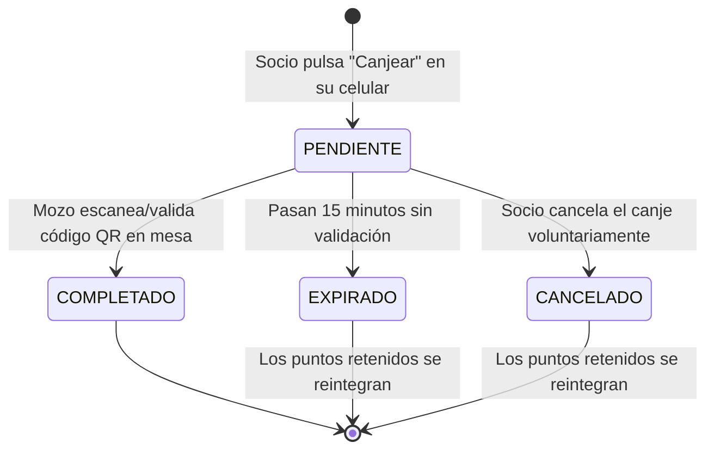

# 06 - Catálogo de Premios y Canjes con Código QR

## 1. Ciclo de Vida del Canje

El proceso de canje garantiza que los puntos se descuenten de forma segura y solo cuando el personal del restaurante entrega el beneficio al socio:

---

## 2. Generación del Cupón QR Temporal
1. El socio elige el premio deseado en el catálogo.
2. Si `puntosActuales >= premio.puntosRequeridos` y `premio.stock != 0`:
   - Se genera un registro `CanjePremio` con estado `PENDIENTE`.
   - Se genera un `codigoQR` único (hash criptográfico seguro de 8 a 12 caracteres alfanuméricos + carga en formato QR).
   - Se congela temporalmente el saldo de puntos correspondiente.
   - Se establece `fechaExpiracion = now() + 15 minutos`.
3. El socio ve en su pantalla:
   - El código QR renderizado en grande.
   - El código alfanumérico legible por si la cámara presenta reflejos.
   - Un temporizador regresivo (`14:59... 14:58...`).
   - Botón "Cancelar Canje" para devolver los puntos inmediatamente si cambió de opinión.

---

## 3. Validación en la Terminal del Personal
El mozo o cajero dispone de la herramienta de validación de canjes:
- **Opción A (Cámara/Escáner):** Escanea el código QR del socio con la cámara de su dispositivo.
- **Opción B (Ingreso Manual):** Escribe el código alfanumérico de 8 caracteres que figura debajo del QR.

**Comprobaciones del Sistema al Validar:**
1. ¿El código existe y su estado es `PENDIENTE`?
2. ¿La fecha actual es menor a `fechaExpiracion`?
3. ¿El socio posee saldo suficiente?
4. ¿El premio tiene stock disponible?

**Efectos de la Validación Exitosa:**
- El estado del canje pasa a `COMPLETADO`.
- Se registra `validadoPorId` y `fechaCanje`.
- Se debita definitivamente el saldo `puntosActuales` del socio.
- Se descuenta 1 unidad del `stock` del premio (si no es ilimitado).
- Se genera una transacción en `TransaccionPuntos` con tipo `CANJE_PREMIO` (valor negativo de puntos).
- La pantalla del socio se actualiza automáticamente a "¡Premio Entregado con Éxito!".

---

## 4. Gestión de Expiraciones y Reintegros Automáticos
- Si transcurren los 15 minutos sin que ningún empleado valide el código, una tarea de fondo (cron) o el propio motor de consulta marca el estado como `EXPIRADO` y libera los puntos retenidos de vuelta al socio sin pérdida económica para el cliente.
